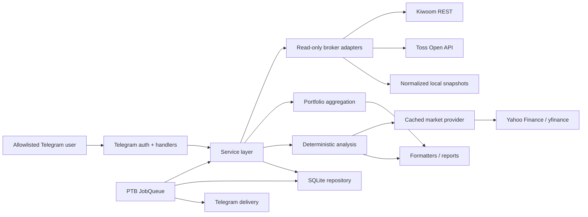
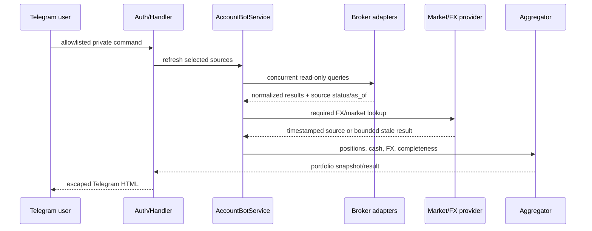

# Architecture

## System Overview

계좌관리봇은 단일 Python asyncio process에서 실행되는 읽기 전용 Telegram application이다. Telegram command와 PTB JobQueue가 동일 service/repository 계층을 사용한다. broker data는 보유·현금·체결의 source of record이고, 시장 데이터는 가격·fundamental·valuation·news를 보강할 뿐 보유 자산을 추정하지 않는다.

최종 사용자 웹 표면은 별도의 owner-only Portflow ChatGPT Site다. 2026-09-18 배포된 production v19는 Sites D1을 사용하며 local FastAPI/SQLite와 동일 runtime 또는 자동 동기화된 database가 아니다. 따라서 아래 Python 구조와 production Site 구조를 혼동하지 않는다.



## Hosted Portflow Site Boundary

production Portflow에서 현재 검증된 사실은 다음과 같다.

- access policy는 owner-only custom access다.
- Site D1에는 `portfolio_positions`, `dca_plan_events`, `dca_purchase_ledger`, `saved_scenarios`, `market_cache`, `user_settings`가 존재한다.
- `dca_purchase_ledger`는 Yahoo Finance 일별 종가와 환율로 계산한 estimated execution이며 실제 broker fill이 아니다.
- v19는 18:00 ET 이후의 마지막 완료 거래일까지 누락 거래일을 멱등 소급 보충하지만 별도 Site automation/schedule은 등록돼 있지 않다.
- production saved version과 local account-bot repository는 서로 다른 source provenance를 가진다. 변경·검증·배포 상태를 각각 추적해야 한다.

Site의 추정 position을 실제 증권사 보유로 표시하거나 local SQLite와 자동 동기화됐다고 가정해서는 안 된다. 실제 체결 여부는 향후 승인된 read-only broker reconciliation이 제공될 때만 확정할 수 있다.

## Application Entry Points

- `python -m account_bot` → `account_bot.__main__` → `account_bot.cli.main`
- installed console script `account-bot` → `account_bot.cli.main`
- `run_account_bot.pyw`: Windows logon/task-scheduler용 무창 launcher; root `.env`와 `run` subcommand 사용
- CLI subcommands:
  - `doctor`: secret 값 없이 configuration availability 출력
  - `init-db`: 명시적 local schema 생성 및 default portfolio 초기화
  - `migrate-db --backup-dir PATH`: 기존 SQLite를 online backup·integrity check 후 최신 schema로 명시적 upgrade
  - `run`: single-instance lock 뒤 Telegram long polling 시작

정상 application startup은 기존 unversioned/pending schema를 자동 변경하지 않는다.

## Major Components

### Configuration and Composition

- `config/settings.py`: dotenv/process environment 병합, path/default, credential pair, timezone, weight, official broker origin validation
- `app.py`: `ApplicationRuntime`과 broker/repository/service/handler/scheduler wiring
- `logging_config.py`: credential/account-like data redaction 및 namespace별 log level
- `runtime_lock.py`: 동일 data directory에 대한 중복 process 방지

설정은 process environment가 dotenv보다 우선한다. Telegram allowlist 또는 fingerprint pepper가 없으면 관련 기능은 fail-closed로 비활성화된다.

### Broker Boundary

- `brokers/base.py`: 주문 메서드가 없는 `ReadOnlyBroker` interface
- `brokers/http.py`: official origin과 method/path/TR rule을 확인한 뒤에만 transport 호출
- `brokers/kiwoom.py`: MAIN과 ACCUM을 별도 logical source로 구성; 국내/미국 조회 응답 정규화
- `brokers/toss.py`: OAuth client credential token cache 및 계좌/보유/현금/완료 주문 조회
- `brokers/snapshot.py`: normalized JSON schema, forbidden key/account-like value, required section, freshness validation
- `brokers/meritz.py`: snapshot adapter specialization

오류는 provider payload를 폐기하고 safe error type/status만 상위 계층에 전달한다. 한 source의 실패는 다른 source의 성공을 무효화하지 않지만, 전체 portfolio completeness와 weight 계산에는 반영된다.

### Domain and Portfolio

- `domain/models.py`: `InstrumentKey`, `Money`, account/position/cash/transaction 및 `Decimal` invariants
- `domain/results.py`: broker status/error/result envelope
- `portfolio/aggregator.py`: compatible instrument 합산, weighted average cost, FX conversion, completeness semantics
- `portfolio/recurring.py`: recurring plan과 fill reconciliation
- `portfolio/recurring_allocation.py`: broker minimum, currency basket bounds, recommendation 계산
- `portfolio_import/`: XLSX raw row 보존, section-aware normalization, amount-based aggregation, blocking preview, immutable snapshot store
- `analysis/scoring.py`: coverage-aware Company/Portfolio/Final score
- `analysis/rebalance.py`: 신규 자금 배분 의견; 매도·주문 없음

Instrument identity와 legacy DB uniqueness가 완전히 같지 않을 수 있으므로 upsert 호환성은 architecture constraint다.

### Services

- `services/portfolio_service.py`: broker 호출 조정, FX 획득, aggregation 및 refresh result 생성
- `services/analysis_service.py`: price/fundamental/valuation/earnings/news/trend를 concurrent 조회하고 deterministic scoring 수행
- `services/storage_adapters.py`: SQLAlchemy recurring plan과 normalized snapshot plan을 domain gateway로 결합

Handler와 scheduler는 service interface를 사용하고 SQLAlchemy session을 공유하지 않는다.

### Market Data and AI Boundary

- `market/base.py`: timestamp/provider를 포함하는 dataset 계약
- `market/yfinance_provider.py`: 선택적 Yahoo/yfinance implementation
- `market/cache.py`, `market/cached_provider.py`: dataset별 TTL, single-flight, bounded last-good fallback
- `market/news.py`: news relevance/impact assessment; 뉴스는 정량 점수에 직접 가산하지 않음
- `market/llm.py`: optional narrative protocol과 payload guardrail

정량 값과 점수는 Python에서만 계산한다. narrative LLM은 현재 composition root에 연결되지 않는다. 향후 provider를 추가해도 입력 JSON 밖 숫자/사실 생성, score 변경, 주문 지시를 금지해야 한다.

### Telegram UI and Reports

- `telegram_ui/auth.py`: allowlisted user ID와 동일한 private chat만 승인
- `telegram_ui/handlers.py`: command parsing, short-lived portfolio refresh cache, service orchestration
- `reports/formatter.py`: Telegram HTML-safe 출력
- `reports/periodic.py`: daily/weekly report 생성

주요 command는 `README.md`를 따른다. 사용자 입력으로 실제 broker order나 transfer가 발생하는 경로는 없다.

### Scheduler

`scheduler/jobs.py`는 Telegram application의 단일 PTB JobQueue를 사용한다.

- 평일 daily report: `DAILY_REPORT_TIME` (기본 08:00, configured timezone)
- weekly valuation refresh: 토요일 08:30 KST 기준 job
- weekly report: `WEEKLY_REPORT_WEEKDAY`/`WEEKLY_REPORT_TIME` (기본 토요일 09:00)
- APScheduler option: coalesce, max instance 1, 1시간 misfire grace
- analysis/valuation fan-out은 bounded semaphore와 `asyncio.gather` 사용

Daily/weekly report는 period와 recipient fingerprint로 DB claim한다. Telegram send 전후 crash ambiguity가 있으면 delivery를 `UNKNOWN`으로 남겨 자동 중복 전송을 피한다.

## Core Data Flows

### Interactive Portfolio Request



### Scheduled Report

1. Job derives period key and refreshes the intended broker scope.
2. Recurring plans and optional analyses are loaded concurrently.
3. Snapshot source states and aggregate values are persisted.
4. Report is claimed by idempotency key and content hash is stored.
5. Recipient destination is represented by HMAC fingerprint.
6. Delivery is claimed, Telegram chunks are sent, then state becomes `SENT`, `FAILED`, or `UNKNOWN`.

## Database and Storage

The default and currently supported repository backend is SQLite through `sqlite+aiosqlite`.

- foreign keys enabled
- WAL journal mode
- configurable busy timeout
- transaction-scoped `AsyncSession`; sessions are never shared across concurrent tasks
- database and runtime directories are machine-local and gitignored
- dialect-specific atomic upserts are isolated in `SQLitePortfolioRepository`

Schema groups:

| Concern | Tables |
|---|---|
| Identity | `portfolios`, `broker_accounts`, `instruments` |
| Portfolio history | `fx_rate_observations`, `portfolio_snapshots`, `snapshot_sources`, `position_snapshots`, `cash_snapshots`, `transactions` |
| Recurring plans | `recurring_buy_plans`, `recurring_buy_revisions`, `recurring_buy_occurrences`, `target_allocations` |
| Thesis and scores | `investment_theses`, `thesis_revisions`, `thesis_assessments`, `company_scores`, `portfolio_scores` |
| Cache and delivery | `market_cache_entries`, `market_fetch_attempts`, `reports`, `report_deliveries` |
| Schema, imports, scenarios | `schema_migrations`, `portfolio_imports`, `raw_portfolio_rows`, `normalized_import_positions`, `market_price_snapshots`, `saved_investment_scenarios`, `saved_scenario_plans` |

Raw account identifiers are transformed to HMAC fingerprints before persistence. 기존 monetary columns는 fixed-precision numeric type을 유지하며 신규 import/price snapshot Decimal은 SQLite에서 exact text representation으로 왕복한다.

Schema version 1은 기존 table을 재작성하지 않고 import snapshot과 향후 provider-attributed market price table만 추가한다. 기존 DB upgrade 전에 SQLite online backup을 만들고 `PRAGMA integrity_check`를 통과해야 한다. 정상 시작은 migration을 수행하지 않으며, 운영 rollback은 사전 backup 복원이 기준이다. 역방향 DDL은 임시 DB 자동 테스트에만 노출된다.

Excel import data flow는 `RawPortfolioRow → NormalizedPosition → AggregatedPosition → ImportPreview`다. marker가 정확히 하나가 아니거나 blocking validation이 있으면 preview는 저장 가능하지만 확정 가능한 상태가 아니다. Excel 평가금액과 가격은 import snapshot이며, 향후 현재 평가의 source of truth는 별도 `MarketPriceSnapshot`/provider가 된다.

## Local Web Dashboard

`web/`의 React/Vite/TypeScript SPA는 localhost FastAPI boundary만 호출한다. `account_bot.web_api`는 Excel preview/commit, 최신 확정 import snapshot 기반 portfolio read, 기존 recurring-plan 저장을 재사용한 daily-buy mutation을 제공한다. 수량·원가·평가액·수익률·납입액 계산은 모두 Python `Decimal`로 수행하며 HTTP에서는 decimal string으로 직렬화한다.

```text
React SPA ── /api/import/preview ── marker-aware XLSX parser
          ├─ /api/import/{id}/commit ── immutable import snapshot tables
          ├─ /api/portfolio ── Decimal aggregation + recurring plan overlay
          └─ /api/daily-buy/{ticker} ── existing SQLite recurring repository
```

웹 runtime은 broker/Telegram service를 조립하지 않으며 주문 경로가 없다. 명시적으로 활성화된 공개 Yahoo/yfinance provider만 ETF 현재가, USD/KRW와 배당·분할 조정 Total Return을 보강한다. provider 정상값은 SQLite market cache, FX observation, market-price snapshot에 저장되고 실패 시 bounded stale 또는 import snapshot으로 내려간다. XNYS calendar와 deterministic projection engine은 Python `Decimal` domain에서 1/3/5/7/10년 값, 월별 wealth timeline과 실제 session 단위 milestone 도달일을 계산하며 React는 decimal string을 표시하고 SVG 좌표만 구성한다.

현금흐름 표시는 별도 distribution series의 최근 12개월 주당 지급액을 현재가격으로 나눈 trailing yield 시나리오다. 자산성장은 adjusted Total Return을 사용하므로 distribution을 다시 더하지 않는다. provider가 지급 구성정보를 주지 않는 경우 dividend/option income/ROC로 추측하지 않고 `UNCLASSIFIED_DISTRIBUTION`으로 유지한다.

확률적 projection은 동일 거래일의 ETF Total Return vector를 정렬한 뒤 20-session block을 fixed seed로 재표본한다. 각 미래 XNYS session마다 수익률을 적용한 후 종목별 적립금을 더하며 잔고는 `Decimal`로 유지한다. CPU 계산은 request loop 밖 thread에서 실행하고 동일 입력의 최근 결과 하나만 memory cache에 유지한다. 3년 미만 공통 이력은 장기 확률분포 신뢰도 경고 대상이다.

Allocation API는 현재 live 평가금액과 deterministic 10년 종목별 ending value를 각각 ticker/category로 합산한 뒤 비중을 다시 계산한다. 수익률과 평균가격을 직접 평균하지 않는다.

ETF detail API는 portfolio holding source를 바꾸지 않고 public market enrichment를 한 종목 단위로 조합한다. Total Return 기간별 metric, volatility/drawdown, distribution events와 미래 종목별 result는 모두 backend Decimal 계산 결과로 반환하며 React modal은 표시만 담당한다.

## Error Handling, Retry, and Caching

- Broker configuration absence returns explicit unavailable/not-configured state.
- Transport/auth/schema failure is sanitized; raw response bodies and credentials do not propagate.
- Missing live response arrays and missing snapshot sections are failure, not empty success.
- Portfolio aggregation preserves partial source states and withholds weights/rebalancing when completeness is insufficient.
- Market dataset cache applies TTL per data kind, prevents duplicate in-flight requests, and permits only bounded stale last-good fallback.
- Scheduler isolates per-instrument analysis failure and per-recipient delivery failure.
- There is no broad automatic broker retry loop; provider-specific pagination/token handling and cache fallback are the current resilience mechanisms.

## Authentication and Security

- Telegram is disabled without bot token; authorization requires non-empty user allowlist.
- Only a private chat whose chat ID equals the allowlisted user ID is authorized.
- Broker base URLs accept only official HTTPS origins encoded in settings validation.
- HTTP requests must match explicit read-only method/path/TR rules before the network transport is called.
- Secret values are `repr=False`/redacted and must never enter logs, docs, Git, DB snapshots, or reports.
- Fingerprint pepper must be at least 16 characters and cannot reuse Telegram/broker credentials.
- Local snapshot parser rejects credential-like keys and account-number-like identifiers.

## Deployment and Operations

There is no Dockerfile or cloud deployment manifest. GitHub Offline CI validates the Python backend/package across Python 3.11–3.14 and the locked React/Vite/TypeScript build; it does not deploy either surface. Telegram은 local Windows/Python long polling이며, 별도 FastAPI/Uvicorn과 Vite SPA는 localhost 개발·개인 사용 표면이다. `run_account_bot.pyw` supports a Windows logon task and uses a lock file to avoid duplicate instances.

## System Invariants

1. Broker interfaces expose read-only operations and HTTP transport accepts only explicit 조회 allowlists.
2. Partial, stale, and unavailable sources remain distinct from zero-valued or complete data.
3. Monetary calculations use `Decimal`; provider and observation timestamps remain attributable.
4. Persistence uses account fingerprints/aliases rather than raw identifiers or credentials.
5. Snapshot/report idempotency and ambiguous Telegram delivery state `UNKNOWN` are part of the storage contract.
6. Forward migrations preserve legacy instrument uniqueness compatibility and use verified backup-first upgrades.
7. Quantitative calculation remains independent from narrative LLM output.
